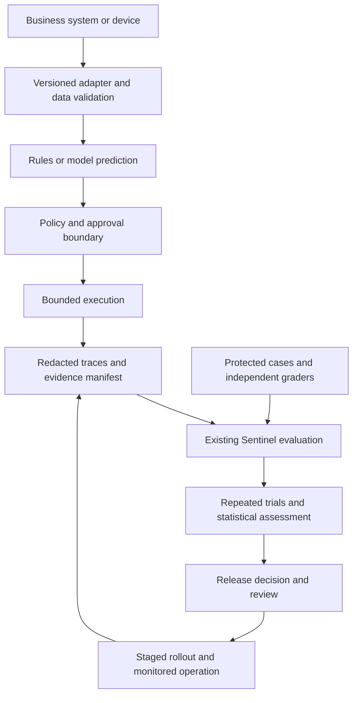

# Sentinel research and longevity blueprint

Evidence reviewed through **8 November 2026**. This is a proposed engineering
extension to Sentinel, not a report of newly implemented functionality.

**Next step: build a continuous reliability assessment layer around Sentinel's
existing evaluation, policy, audit, trace, and data-quality controls.** Its first
deliverable is a repeated-trial evaluation report with uncertainty, explicit
failure reasons, and a reproducible release decision. Add learned models only
when they improve a defined business outcome against a simpler baseline.

## Strategic category and boundaries

Sentinel's strongest primary category is **AI reliability and assurance
infrastructure**. Its supporting categories are evaluation engineering,
data quality and MLOps, secure automation, and operational observability.
These share evidence contracts and release controls. Model research belongs
in optional adapters and experiments, so a new model does not change who may
authorize actions or redefine a passing test.

NeuroAI is a research track. It is not Sentinel's product category. A neural
network, a programming language, an automation engine, and an assurance system
solve different problems; none substitutes for the others.

“Highest performance” means the best validated trade-off among task quality,
error severity, latency, throughput, resource use, cost, and maintainability
for a specified workload. No model or language wins universally. Reusable
interfaces can serve many businesses; datasets, permissions, acceptance
criteria, and domain validation must be adapted for each deployment.

## Starting point in this repository

Baseline inspected: commit `3b2e7cf0716e3940ef5f8af7beb0177408afe333`.
The package declares version 0.6.0. Historical roadmap labels are planning
labels, not proof that every item in a numbered section is implemented.

| Existing foundation | Proposed extension |
| --- | --- |
| Strict `EvalCase` and `AgentRun` contracts; deterministic evaluation and paired comparisons | Repeated trials, confidence intervals, perturbation suites, and explicit evidence sufficiency |
| OTLP import with topology checks, redaction, and provenance manifests | Sampled operational evaluations with missingness tracked separately from failure |
| Training-data gates | Dataset cards, leakage checks across related entities, annotation review, and external holdouts |
| Optional PostgreSQL evaluation history | Longitudinal reliability and drift reports using the existing storage boundary |
| Policy enforcement and audit chains | Independent evidence anchoring and recovery drills before stronger completeness claims |
| Python, TypeScript, and Go audit verifiers | Shared compatibility fixtures for future Java/C++ integrations when demanded |
| Weighted candidate-review calibration | A separate probability-calibration protocol for learned predictions |

The current review rubric ranks evidence; its score is not a probability that
code is correct. A deterministic evaluator also does not make an underlying
model deterministic. Preserve these distinctions in reports and public claims.
See the [architecture](../ARCHITECTURE.md), [existing calibration protocol](../../projects/governed-ai-code-eval-system/docs/MODEL_CALIBRATION_PROTOCOL.md),
and [maintenance standard](MAINTENANCE.md).

## University research translated into engineering decisions

The university list is a research scope, not a verified university ranking.
The following are attributed findings or research directions. The engineering
actions are proposed applications to Sentinel, not university endorsements.

| Institution and evidence | Finding and limit | Sentinel decision |
| --- | --- | --- |
| **MIT**, *The 2025 AI Agent Index*, 2026; [paper](https://arxiv.org/abs/2602.17753v1) and [methodology](https://aiagentindex.mit.edu/2025/further-details) | Documents 30 deployed agents using public information and developer correspondence. Safety and evaluation disclosure is uneven. This is a documentation study, not an experimental safety rating. | Maintain a versioned inventory of agents, models, tools, permissions, evaluation evidence, and incident owners. |
| **Stanford**, *Fantastic Bugs and Where to Find Them in AI Benchmarks*, NeurIPS 2025; [research report](https://ai.stanford.edu/blog/fantastic-bugs/) | Across nine benchmarks, methods prioritize flawed questions for human review with up to 84% precision@k. This is defect-finding precision in the studied setting, not model accuracy or a universal defect detector. | Audit expected answers and graders; keep disputed cases visible and version corrections. |
| **Carnegie Mellon**, *Towards Efficient Generative Large Language Model Serving*, 2025; [survey](https://doi.org/10.1145/3754448), plus [ICML 2025 work](https://blog.ml.cmu.edu/2025/07/08/carnegie-mellon-university-at-icml-2025/) on external flaw disclosure | Serving efficiency spans algorithm and system choices. External disclosure complements internal evaluation. A survey and position paper do not establish a universal production speedup. | Benchmark the entire request path and retain a reproducible defect-report and independent-review process. |
| **NUS**, *zkGPT*, USENIX Security, August 2025; [paper and authors](https://www.usenix.org/conference/usenixsecurity25/presentation/qu-zkgpt) | Reports approximately 279× and 185× speedups over two prior proof systems. The GPT-2 inference demonstration verifies computation, not truth or appropriateness of generated answers. | Keep execution provenance and semantic correctness as separate evidence fields. Evaluate cryptographic inference proofs only for a concrete customer requirement. |
| **UC Berkeley**, 2026 benchmark-integrity research; [institutional report](https://rdi.berkeley.edu/blog/trustworthy-benchmarks), [BenchJack preprint](https://arxiv.org/abs/2605.12673) | The institutional report describes 45 confirmed hacking solutions across 13 audited benchmarks. These are harness vulnerabilities, not an estimate of all deployed agents' failure rates. | Isolate candidate execution from graders, immutable fixtures, credentials, and scoring state; test score manipulation explicitly. |
| **Oxford**, *Measuring what Matters*, NeurIPS 2025; [paper](https://arxiv.org/abs/2511.04703v1) | A team of 29 expert reviewers examines 445 LLM benchmarks and finds weaknesses in what tests measure and how claims follow from scores. | Define each business capability, its observable outcome, and scoring limits before collecting scores. |
| **NTU**, Gong, Yan and collaborators, *Large language models discover complementary heuristics for combinatorial optimization*, 1 October 2026; [paper](https://www.nature.com/articles/s42256-026-01307-8) | LACE scores 0.945 on average across 36 CO-Bench problems, versus 0.870 for the strongest compared LLM method and 0.571 for direct prompting. These benchmark scores are not percentages of business success or proven optimality. | Prototype optimization-code generation behind validated input/output contracts, feasibility checks, execution limits, and independent tests. |
| **Tsinghua**, *Scalable and Adaptive Trust-Region Learning via Projection Convex Hull*, ICLR 2026; [institutional account dated 29 April](https://www.eea.tsinghua.edu.cn/en/info/1038/3605.htm), [paper](https://openreview.net/forum?id=Kjcs0xJxdg) | Learns explicit convex regions that can constrain later decisions to data-supported areas. The institutional account does not supply a universal deployment failure rate. | Begin with explicit input-domain checks and abstention. Compare learned trust regions as an optional experiment. |
| **University of Birmingham Dubai**, [campus AI research theme](https://www.birmingham.ac.uk/dubai/research/artificial-intelligence) | Campus-specific initiatives include AI and genomics for UAE diabetes heterogeneity and interpretable traffic research. The cited project page does not establish completed validation results or comparative accuracy. | Use this as a domain-transfer research lead. Require a completed study, local validation, and domain review before making performance claims. Do not substitute Birmingham UK results for Dubai-campus evidence. |

This is a selected recent evidence base, not an exhaustive literature review.
The newest directly checked experimental paper above is dated October 2026.
Original papers, surveys, preprints, and project announcements carry different
evidentiary weight; none alone demonstrates Sentinel's operational performance.

## Neuroscience and AI

Artificial neural networks learn parameterized transformations. Deep neural
networks use multiple learned layers; deep learning is a subset of machine
learning. These names do not establish biological equivalence, consciousness,
or human-like understanding.

The April 2026 **NeuroAI and Beyond** roadmap, revised in May, includes Stanford
and CMU affiliations. It discusses hierarchical control, learning across
timescales, prediction through interaction, and sparse event-driven computation.
It is a research agenda, not a validated production recipe.
[Roadmap and affiliations](https://arxiv.org/html/2604.18637v2).

| Research idea | Practical experiment | Required evidence before adoption |
| --- | --- | --- |
| Hierarchical control | Keep rapid deterministic policy checks below slower model planning | Hard constraints still hold when the planner fails, times out, or receives malicious input |
| Memory and continual learning | Replay representative earlier tasks when evaluating a newly trained model | Report forgetting on old tasks and gains on new tasks; preserve data permissions and deletion requirements |
| Prediction and uncertainty | Detect unfamiliar inputs and allow abstention | Measure selective risk, coverage, calibration, and escalation workload |
| Sparse/event-driven processing | Test only for sensor or edge workloads where events are naturally sparse | Measure end-to-end energy, latency, and quality on actual hardware; include preprocessing overhead |

These are engineering hypotheses inspired by research. Do not enable autonomous
production retraining. New data creates a candidate dataset and model version;
the same evaluation and release process still applies.

Oxford's earlier semantic-entropy research offers an additional uncertainty
signal for generated answers. It requires repeated generation and does not
detect every confident systematic error. Treat it as an optional signal with
measured cost, not a truth detector.
[Oxford research explanation, June 2024](https://www.ox.ac.uk/news/2024-06-20-major-research-hallucinating-generative-models-advances-reliability-artificial).

## Model selection by strongest use case

Machine learning is the umbrella category. Statistical, Bayesian, tree,
distance-based, kernel, and neural methods overlap in purpose. Give each
implementation one owning adapter, with secondary tags for search and reporting;
do not duplicate models or create competing sources of truth.

| Method and primary category | Designed for and strongest starting use | Performance conditions and limits | Clean integration |
| --- | --- | --- | --- |
| **Statistical models** — estimation and forecasting | Linear/logistic regression, generalized linear models, and time-series baselines for demand, rates, trends, and interpretable associations | Check residuals, dependence, seasonality, regularization, and temporal validation. Association alone does not establish causation. | Start with a small baseline and return a prediction plus uncertainty where justified. |
| **Random Forests** — tabular supervised learning | Classification/regression with nonlinear feature interactions, such as ticket triage or equipment-risk prediction | Tune tree depth, leaf size, feature sampling, imbalance handling, and memory. Check probability calibration. Weak choice for extrapolating trends beyond observed targets. | Version the entire preprocessing-plus-forest artifact; expose structured features and predictions. |
| **K-Nearest Neighbors** — similarity-based prediction | Small/moderate datasets where a meaningful distance connects nearby examples to similar outcomes | Scale features inside training folds, tune k and distance, measure memory and query latency. High dimensions can destroy distance usefulness. | Keep the reference dataset and metric versioned. Approximate vector retrieval is related infrastructure, not automatically a validated KNN classifier. |
| **Probabilistic and Bayesian methods** — uncertainty-aware inference | Small-data estimation, hierarchical groups, noisy observations, sequential updating, and decision-making under uncertainty | Check prior sensitivity, likelihood assumptions, posterior predictive fit, and sampling convergence where applicable. Bayesian output is conditional on the model assumptions. | Return distributions or intervals with model assumptions. Evaluate probabilistic quality, not only point accuracy. |
| **Symbolic regression** — equation discovery | Compact interpretable equations for low-dimensional scientific or operational relationships | Constrain operators, units, complexity, and numerical domains. Test outside the fitting range. An attractive equation is not a discovered causal law. | Run search offline; approve and version a bounded expression evaluator. Never execute untrusted generated expressions directly. |
| **Support Vector Machines** — margin-based supervised learning | Small/moderate high-dimensional classification; linear SVMs for sparse text; SVR for suitable regression tasks | Scale appropriately; tune C and kernel parameters. Nonlinear kernels can become expensive on large datasets. Raw margins are not calibrated probabilities. | Version preprocessing, estimator, and any separately fitted probability calibrator. |
| **Neural networks and deep neural networks** — representation learning | Images, audio, text, multimodal inputs, and complex learned representations | Prefer suitable pretrained models when justified. Measure data requirements, shift, memory, inference cost, calibration, and reproducibility. Larger is not automatically better. | Keep model execution behind an adapter; evaluate CNNs for spatial signals, transformers for language/sequence tasks, and other architectures only against relevant baselines. |
| **Gradient-boosted trees** — tabular challenger | A strong additional comparison for structured business data | Tune against leakage-safe validation and the same resource budget as other candidates. Do not assume a universal advantage over forests or neural models. | Use the same prediction and evaluation contracts. |
| **Rules and constrained optimization** — explicit decisions | Known policies, accounting identities, hard feasibility constraints, routing and scheduling | Rules require maintenance; optimization requires correct constraints and acceptable solve times. | Keep hard rules authoritative; models can estimate inputs or propose feasible candidates. |

Method references: [scikit-learn supervised learning](https://scikit-learn.org/stable/supervised_learning.html),
[probability calibration](https://scikit-learn.org/stable/modules/calibration.html),
and [PySR symbolic regression](https://pysr.ai/dev).
These established methods are included because they fit problems, not because
each has a newly verified 2026 paper from every listed university.

Selection sequence: define outcome → establish rules/statistical baseline →
compare appropriate model families → validate on untouched data → measure
quality and resource trade-offs → choose the simplest candidate meeting all
requirements. Combine models only when measured complementary gains exceed
the extra failure modes and support cost.

## Languages and current demand

The four leading languages in the checked **US software-developer job-posting
dataset** are Python, Java, SQL, and JavaScript. O*NET reports mentions in
29%, 25%, 24%, and 20% of unique postings linked to occupation 15-1252,
respectively, during January–December 2025. Multiple skills can occur in one
posting. These are job-ad mentions, not hires or a global ranking; SQL is a
query language. The source was updated in October 2026.
[O*NET employer-based data](https://www.onetonline.org/link/hot_tech/15-1252.00).

| Language | Best role in this plan | Implementation discipline |
| --- | --- | --- |
| **Python** | Preserve Sentinel's core; evaluation, data pipelines, statistical/ML experiments | Strict typing, schema validation, pinned experiment environments; vectorize or use optimized libraries before rewriting |
| **TypeScript** | Typed web applications, integration clients, and the existing independent verifier | Strict types plus runtime validation at every external boundary; compile-time types cannot validate remote JSON |
| **JavaScript** | Browser/runtime interoperability; one of the four demand leaders above | Prefer TypeScript for new maintained application code where the team supports it; test produced JavaScript behavior |
| **SQL** | PostgreSQL evidence history, integrity constraints, reproducible analytical queries | Parameterized queries, migrations, least-privilege roles, indexes based on actual query plans |
| **Java** | Enterprise service integration where a customer already runs JVM systems | Add an adapter or SDK only for a real integration; contract and concurrency tests; do not rewrite the Python evaluator |
| **C++** | Measured latency-critical native inference, numerical kernels, robotics or edge integration | Profile first; isolate native boundaries; use sanitizers, fuzzing, ownership discipline, and compiler-specific checks |
| **Go** | Preserve existing verifier; optional small operational services | Shared conformance vectors and bounded concurrency |
| **Rust** | Optional memory-safe native component when a requirement justifies a new toolchain | Benchmark against existing implementations and include operational ownership cost |

Start with **Python + SQL + TypeScript**, retaining existing Go verification.
Java and C++ remain supported integration directions, not mandatory services.
Demand evidence guides skills investment; actual latency, ecosystem, team
capacity, and interoperability determine implementation choices.

## Architecture that scales by need

The diagram describes a target architecture. Prediction, authorization,
execution, and evaluation have separate contracts. For analysis-only workflows,
there may be no execution step. For physical or hard real-time systems, native
certified controllers and device safety limits remain in the control loop;
Sentinel can assess evidence outside that loop.

### Data and model contracts

Add a versioned assessment manifest beside existing `AgentRun` records rather
than silently adding fields to their strict schema. Proposed fields include
assessment ID, case/version, trial ID, dataset/split hashes, source commit,
model/provider version, prompt and tool versions, runtime/image digest,
hardware, seed where supported, preprocessing version, policy hash, and
evaluator version. Record unavailable provider details explicitly.

An optional prediction contract should carry task type, prediction, units or
class labels, probability/interval if available, calibration version,
input-domain status, evidence references, and abstention reason. An arbitrary
“confidence” number without a defined statistical meaning is invalid evidence.

Keep raw permitted data, transformed features, labels, and reports separately
versioned. Define ownership, collection rights, retention, deletion, and
redaction before ingestion. Split by time, customer, patient, device, or other
independent entity as the task requires. Fit imputation, scaling, feature
selection, and calibration using only their assigned training/validation data.
Keep the final test set inaccessible to candidate generation and tuning.

### Infrastructure and efficiency

Use existing JSONL workflows for a single operator and PostgreSQL history when
querying across releases becomes necessary. Add immutable object storage for
large artifacts and externally anchored audit checkpoints when the evidence
requirement warrants it. Add queues when slow jobs need durable retries or
backpressure. Introduce distributed orchestration only after a measured
availability or throughput requirement exceeds a simpler deployment.

Classical models often start well on CPUs. GPU capacity is justified by measured
training/inference requirements. Compare batching, quantization, caching,
distillation, and model routing using identical workload distributions and
quality gates. Recheck output quality after each optimization. Include queue
delay, cold starts, memory, concurrency, and tail latency; tokens/second alone
does not describe customer experience. Cache keys must include model, data,
policy, and tenant context where relevant.

### Automation and coding

Prefer an explicit state machine for repeatable workflows. Use a model for
ambiguous reasoning only where tests demonstrate value. Persist run state;
give external writes idempotency keys; bound retries with backoff and deadlines;
provide cancellation and dead-letter handling. A retried request is not proof
of exactly-once delivery: reconcile external state before repeating an effect.

Generated code runs in an isolated worker without production credentials or
grader access. It must pass compilation/type checks, unit and integration
tests, security checks, resource limits, and independent task assertions.
Record dependencies and licenses. Authorization and approval requirements come
from the deployment's policy, not from the model's own output.

## Evaluation protocol and release evidence

1. **Define the claim.** Name the business task, target population, failure
   severity, acceptable risk, cost/latency limits, and accountable owner before
   selecting a model. A substring match establishes only that match, not full
   semantic correctness.
2. **Establish comparison data.** Separate training, tuning/calibration, and
   final evaluation sets. Use grouped or temporal splits where needed. Preserve
   an external or later-period holdout for meaningful generalization claims.
3. **Repeat and perturb.** Run multiple trials per case, tracking repeated
   observations as correlated. Test equivalent wording, noise, missing inputs,
   tool outages, retry storms, permissions, injection attempts, and shifted data.
4. **Report the right metrics.** Classification: precision/recall, confusion
   matrix, PR-AUC for suitable rare-event tasks, and per-group results.
   Regression: MAE/RMSE in business units and interval coverage. Forecasting:
   rolling-origin evaluation. Probabilistic predictions: log loss/Brier score
   plus reliability curves; these scores measure more than calibration alone.
   Agents: task completion, forbidden actions, repeatability, abstention,
   human escalation, cost per successful task, and p50/p95/p99 latency.
5. **Compare fairly.** Pair baseline/candidate by case and trial identifiers.
   Report effect sizes and uncertainty, using case-cluster resampling when
   repeated trials share cases. Predeclare primary metrics and account for
   multiple comparisons. Preserve all failures and missing observations.
6. **Gate independently.** Any prohibited action or integrity failure blocks
   promotion. Insufficient evidence yields an inconclusive statistical result,
   never an inferred pass. Quality, cost, latency, and recovery gates remain
   separate; no weighted average can buy out a hard safety failure.

Fit probability calibration on independent data and test it on untouched data.
Choose sigmoid, isotonic, or temperature methods according to data volume and
output type. Inspect reliability by relevant subgroup and distribution shift.
Conformal intervals require stated assumptions, commonly exchangeability;
nominal marginal coverage does not promise coverage for every subgroup or
after arbitrary drift. [Calibration guidance](https://scikit-learn.org/stable/modules/calibration.html).

**Illustrative sample-size boundary:** if 300 independent representative trials
show zero failures, the one-sided 95% binomial upper bound is
`1 - 0.05^(1/300)`, approximately **0.994%**, not zero. Repeating a small fixed
set of synthetic cases does not establish that bound for arbitrary production
traffic. Choose sample size from the claimed risk limit and dependence structure.

The existing 20-scenario synthetic assessment remains conformance evidence.
Use it to test the harness; do not train a risk classifier on it and advertise
production prediction accuracy. Compare an initial rules/logistic baseline
with a Random Forest only once adequate representative labels exist.

## Implementation sequence

Timeboxes below are planning estimates for available engineering capacity,
not completion promises. Dependencies and exit evidence determine progression.

| Phase | Work and accountable role | Exit evidence |
| --- | --- | --- |
| **First 2 weeks** | Maintainer: define one pilot workflow; add versioned assessment manifest; implement repeated-trial statistics around existing evaluation reports | Known-answer statistical tests, malformed-input rejection, deterministic replay of stored observations, paired baseline comparison, explicit insufficient-evidence handling |
| **Weeks 3–4** | Evaluation owner and domain reviewer: audit cases, labels, graders, uncertainty and probability calibration protocol | Independent review of sampled cases; grader-tampering tests; holdout/split manifest; report distinguishing synthetic and operational evidence |
| **Days 31–60** | Integration/operator role: connect one consenting pilot in shadow mode; store minimized evidence; measure costs and failure detection | No automated business writes in shadow mode; adjudicated false alarms/missed failures; tested restore, cancellation, and rollback; agreed resource budgets |
| **Days 61–90** | Maintainer plus independent reviewer: assess staged rollout and one optional model challenger | Reproducible improvement on the declared outcome, no hard-gate regression, acceptable support cost, and evidence-backed go/no-go decision |
| **After pilot proof** | Research owner: test LACE-style constrained code generation, learned trust regions, NeuroAI hypotheses, or inference proofs | Separate experiment report and reproduction; adoption only if it outperforms the maintained baseline under real constraints |

### First implementation package

Proposed locations, subject to implementation review:

- `Sentinel/src/sentinel/reliability.py`: statistics over validated evaluations,
  separate from deterministic per-run scoring.
- `Sentinel/schemas/reliability-assessment-v1.schema.json`: manifest/report
  contract, explicit uncertainty and evidence status.
- `Sentinel/tests/test_reliability.py`: known-answer intervals, pairing,
  correlated-trial handling, empty/missing data, and hard-failure preservation.
- `Sentinel/examples/reliability_assessment/`: extend the existing example with
  repeated observations and clearly labeled synthetic reports.
- `Sentinel/docs/EVALUATION_HISTORY.md`: document any storage extension and
  compatibility/migration requirements after its implementation.

Avoid introducing all model libraries into the core package. Use optional
extras or isolated experiment environments so basic governance and audit
verification remain installable without GPUs or research dependencies.

## Adoption for businesses of different sizes

| Context | Initial shape | First valuable workflow | Expansion trigger |
| --- | --- | --- | --- |
| Solo operator or small business | Offline CLI, versioned files, existing deployment | Assess document processing or support suggestions before accepting outputs | Evidence volume or collaboration makes shared history useful |
| Growing team | Containerized evaluator, PostgreSQL, CI checks, controlled queue | Compare model releases on real tickets or internal automation | Measured concurrency, isolation, recovery, or audit requirements |
| Enterprise | Tenant separation, identity integration, centralized evidence storage, independent review | Govern one bounded integration before expanding authority | Demonstrated value and named owners for security, data, operations, and domain decisions |
| Edge or industrial setting | Local model/native adapter with offline evidence export | Predict maintenance or assess routing proposals | Device-specific latency, energy and safety validation; never assume a cloud control loop is appropriate |

For each pilot, measure current review time, costly missed failures, false
alarms, integration effort, recurring compute/storage costs, and support time.
Calculate value from the same agreed tasks before and after adoption. A small
business can combine roles, but independent review status must remain explicit.
High-consequence domains need specialist validation regardless of company size.

## Longevity and consistency controls

Extend the existing [maintenance plan](MAINTENANCE.md), preserving its current
dependency review and image-rescan processes.

| Cadence or trigger | Required action | Durable evidence |
| --- | --- | --- |
| Every change | Run relevant tests and protected release checks; preserve schema compatibility | Source commit, test results, case versions, artifact digests, owner |
| Model/provider/prompt/tool/data change | Reevaluate affected tasks and unchanged controls before promotion | Paired results, uncertainty, costs, decision rationale |
| Weekly | Review existing dependency/rescan findings and new failures | Triaged findings and owners, including unavailable scans |
| Monthly | Review operational drift, label delay, false alarms, resource cost, support load, and runtime support | Maintenance decision and evidence gaps |
| Quarterly | Review new primary research, reproduce selected findings, rehearse recovery and evidence export | Adoption/rejection record, recovery results, research source/version |
| Incident or material distribution shift | Restrict affected automation; preserve evidence; investigate and validate a correction | Incident record, regression case, recovery and re-release evidence |

Define drift thresholds from observed baselines and acceptable error costs.
Feature drift can trigger investigation; it does not by itself prove predictive
failure. Monitor delayed outcomes when labels arrive. Retraining creates a
candidate, not an automatic production replacement.

Pin model/data/tool versions where possible; record provider changes when
pinning is unavailable. Keep machine-readable exports and documented migration
paths. Maintain an owner, supported-runtime policy, deprecation notice, backup
and restore procedure, and second-maintainer plan. Delete unused capabilities
when their maintenance burden exceeds their demonstrated value.

## Research-grade standard of proof

The desired postdoctoral level is expressed through inspectable scientific and
engineering work: a precise question, appropriate baselines, reproducible
environment, justified statistical methods, ablations, failure analysis,
external validation, and independent reproduction. It is not a credential or
certification that a plan can confer.

Each promoted experiment should include a dataset/model card, split manifest,
training and inference configuration, source/environment digests, raw permitted
results, uncertainty estimates, resource measurements, limitations, security
review, and a named decision owner. Publish negative findings when permission
allows. Record where independent reproduction is still pending.

**Completion of the next milestone:** Sentinel can reproduce a bounded
reliability claim, show uncertainty and failure evidence, refuse promotion when
evidence is inadequate, and explain the decision in language a business owner
can understand. Production trust must then be earned in the intended operating
environment.
